<div align="center">




</div>

<div align="center">
  
</div>

##  About me

```c
struct developer rayane = {
    .alias     = "LaCreammme",
    .education = "2nd Year Preparatory Cycle, Computer Science, UIR (Rabat)",
    .exploring = {"systems", "networks", "databases"},
    .building  = "ocsh, a mini-shell written in C"
};
```

## 🛠️ Stack and tools

<div align="center">


<br/><br/>


</div>

## 🚀 Projects

| Project | Description | Tech | Status |
|---|---|---|---|
| **ocsh** | Mini-shell: `fork`, `exec`, `pipe`, `dup2` (team project) | C, Linux | 🔨 In progress |
| **RevApp** | Weekly course review app | Personal | 💡 Planned |

## 🎯 Current goals

- [ ] Finish ocsh, milestone by milestone
- [ ] Go deeper into routing and network administration
- [ ] Keep improving my technical English

## 📊 GitHub activity

<div align="center">


</div>

## 🐍 My contributions

<div align="center">
  <picture>
    <source media="(prefers-color-scheme: dark)" srcset="https://raw.githubusercontent.com/LaCreammme/LaCreammme/output/snake-dark.svg" />
    
  </picture>
</div>

## 📫 Get in touch

<div align="center">

<a href="https://github.com/LaCreammme"></a>


</div>
